<h1 align="center">
  <picture>
    <source media="(prefers-color-scheme: dark)" srcset="brand/readme/hero-dark.svg">
    
  </picture>
</h1>

<p align="center"><b>Free, hands-on AI courses that run anywhere</b>, from the team building <a href="https://synapsa.realai.eu">Synapsa</a>, an AI-native learning platform.</p>

<p align="center"><a href="https://github.com/TarrySingh/Artificial-Intelligence-Deep-Learning-Machine-Learning-Tutorials/actions/workflows/lessons.yml"></a></p>

<p align="center"><a href="#start-here">Start here</a> · <a href="#choose-your-path">Choose your path</a> · <a href="#the-map">The map</a> · <a href="#whats-coming">What's coming</a> · <a href="#how-a-lesson-works">How a lesson works</a> · <a href="#the-bar-every-lesson-clears">Quality</a></p>

> Looking for the 2017-2025 tutorials? They are retired; [what changed, and why](#the-2017-2025-tutorials).

## Start here

<!-- GEN:start:BEGIN generated by tools/status.py; do not edit -->

**[The 8 GB track](lessons/T00-L01-the-8gb-track/lesson.ipynb)** · ~40 minutes · a laptop CPU, 8 GiB RAM, no GPU, no download · Python · no lesson to do first

<a href="https://colab.research.google.com/github/TarrySingh/Artificial-Intelligence-Deep-Learning-Machine-Learning-Tutorials/blob/master/lessons/T00-L01-the-8gb-track/lesson.ipynb"><picture><source media="(prefers-color-scheme: dark)" srcset="brand/readme/open-colab-dark.svg"></picture></a> <a href="https://kaggle.com/kernels/welcome?src=https://github.com/TarrySingh/Artificial-Intelligence-Deep-Learning-Machine-Learning-Tutorials/blob/master/lessons/T00-L01-the-8gb-track/lesson.ipynb"><picture><source media="(prefers-color-scheme: dark)" srcset="brand/readme/open-kaggle-dark.svg"></picture></a> <a href="https://mybinder.org/v2/gh/TarrySingh/Artificial-Intelligence-Deep-Learning-Machine-Learning-Tutorials/master?labpath=lessons/T00-L01-the-8gb-track/lesson.ipynb"><picture><source media="(prefers-color-scheme: dark)" srcset="brand/readme/open-binder-dark.svg"></picture></a> <a href="https://codespaces.new/TarrySingh/Artificial-Intelligence-Deep-Learning-Machine-Learning-Tutorials"><picture><source media="(prefers-color-scheme: dark)" srcset="brand/readme/open-codespaces-dark.svg"></picture></a>

Build a profiler that measures what any piece of Python really costs in time and memory, rank four implementations of one task on the numbers, and reproduce the compute-tier check every lesson here has to pass.

1. Pick a service. Binder needs no account; Colab, Kaggle and Codespaces ask you to sign in, and in Codespaces you open the lesson's `lesson.ipynb` yourself.
2. Press **Run all**. Every cell runs, each unfinished exercise says so, and a progress board ends the notebook.
3. Fill in the first exercise and re-run its cell. Its check tells you whether you are right and, if not, what the likely mistake is.

<details><summary>What this lesson assumes you can already do</summary>

- write a Python function with a loop and a try/finally block, define a NamedTuple, and read a traceback to find the failing line
- create and slice a numpy array, and call methods such as .sum() on it
- say what RAM is, as opposed to disk, and what happens to a program that asks for more of it than the machine has

New to some of that? Free places to learn it:

- [The Python Tutorial, section 8: Errors and Exceptions](https://docs.python.org/3/tutorial/errors.html) · Python Software Foundation
- [NumPy user guide: Data types](https://numpy.org/doc/stable/user/basics.types.html) · NumPy project
- [tracemalloc: Trace memory allocations](https://docs.python.org/3/library/tracemalloc.html) · Python Software Foundation
- [Operating Systems: Three Easy Pieces](https://pages.cs.wisc.edu/~remzi/OSTEP/) · Arpaci-Dusseau and Arpaci-Dusseau

</details>

<!-- GEN:end -->

## Choose your path

<p align="center">
<a href="lessons/README.md#start-from-zero"><picture><source media="(prefers-color-scheme: dark)" srcset="brand/readme/path-new-dark.svg">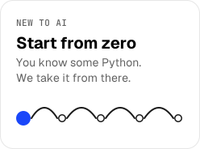</picture></a>
<a href="lessons/README.md"><picture><source media="(prefers-color-scheme: dark)" srcset="brand/readme/path-engineer-dark.svg">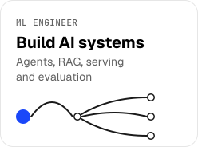</picture></a>
<a href="#programmes"><picture><source media="(prefers-color-scheme: dark)" srcset="brand/readme/path-field-dark.svg">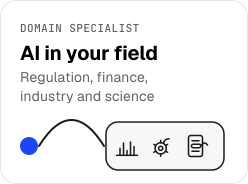</picture></a>
</p>

<!-- GEN:paths:BEGIN generated by tools/status.py; do not edit -->

- **New to AI.** Begin with some Python and take these in order, each needing only the lessons before it: [The 8 GB track](lessons/T00-L01-the-8gb-track/lesson.ipynb) → [Byte-level BPE from scratch](lessons/T03-L01-bpe-from-scratch/lesson.ipynb) → [The CPU slice of nanolm](lessons/T03-L03-nanolm-cpu-slice/lesson.ipynb) → [Retrieval from scratch](lessons/T06-L01-retrieval-from-scratch/lesson.ipynb) → [The agent loop from scratch](lessons/T07-L01-agent-loop-from-scratch/lesson.ipynb). The same path with launch links is in [the track lessons](lessons/README.md#start-from-zero).
- **ML engineer.** [Agents and protocols](lessons/README.md#agents-and-protocols) · [Retrieval and RAG](lessons/README.md#retrieval-and-rag) · [Inference systems](lessons/README.md#inference-systems) · [Post-training](lessons/README.md#post-training) · [Evaluation and governance](lessons/README.md#evaluation-and-governance) · [AI engineering](lessons/README.md#ai-engineering) · [Language models](lessons/README.md#language-models)
- **Domain specialist.** [EU AI Act conformity](programmes/ai-act-conformity/) · [Model risk](programmes/model-risk/) · [Predictive maintenance](programmes/predictive-maintenance/) · [Document intelligence](programmes/document-intelligence/) · [Credit underwriting](programmes/credit-underwriting/) · [Proteomics and multiomics](programmes/proteomics-multiomics/) · [AI for science](lessons/README.md#ai-for-science) · [Humanoid Lab](flagships/humanoid-lab/)

<!-- GEN:end -->

## The map

The courses aim at the work people are paid for: evidence an inspector can re-run, a model a
risk committee can sign off, an alarm a plant manager will trust. Every number a lesson prints is
computed by code you run, and every claim it makes about the world cites a primary source.

<!-- STATUS:BEGIN generated by tools/status.py from the lessons themselves; do not edit -->

**84 lessons, every one passing all 14 gates in `QUALITY.md` and independently reviewed.** 7 are compiled C or C++ exercises. Every notebook opens in Colab, Kaggle, Binder, Codespaces or local Jupyter. Every `MODULES.md` marks a module built only when its lesson exists and has passed; everything else says `specified`, and means it.

### Programmes

<p align="center">
<a href="programmes/ai-act-conformity/"><picture><source media="(prefers-color-scheme: dark)" srcset="brand/areas/p01-tile-dark.svg">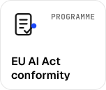</picture></a>
<a href="programmes/document-intelligence/"><picture><source media="(prefers-color-scheme: dark)" srcset="brand/areas/p02-tile-dark.svg">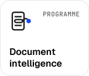</picture></a>
<a href="programmes/predictive-maintenance/"><picture><source media="(prefers-color-scheme: dark)" srcset="brand/areas/p03-tile-dark.svg">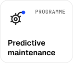</picture></a>
<a href="programmes/model-risk/"><picture><source media="(prefers-color-scheme: dark)" srcset="brand/areas/p04-tile-dark.svg">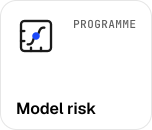</picture></a><br>
<a href="programmes/credit-underwriting/"><picture><source media="(prefers-color-scheme: dark)" srcset="brand/areas/p05-tile-dark.svg">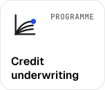</picture></a>
<a href="programmes/proteomics-multiomics/"><picture><source media="(prefers-color-scheme: dark)" srcset="brand/areas/p07-tile-dark.svg">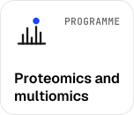</picture></a>
<a href="flagships/humanoid-lab/"><picture><source media="(prefers-color-scheme: dark)" srcset="brand/areas/f15-tile-dark.svg">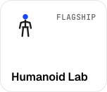</picture></a>
</p>

- **[EU AI Act conformity](programmes/ai-act-conformity/)** · 9 of 9 modules built. Show that an AI system meets the EU AI Act, with evidence an inspector can re-run. Start with [The conformity evidence pack](lessons/T10-L01-ai-act-conformity-pack/lesson.ipynb).
- **[Document intelligence](programmes/document-intelligence/)** · 11 of 11 modules built. Pull fields out of invoices and contracts, and prove how often you are wrong. Start with [Field extraction you can measure](programmes/document-intelligence/lessons/P02-L01-extraction-evaluation/lesson.ipynb).
- **[Predictive maintenance](programmes/predictive-maintenance/)** · 9 of 9 modules built. Take predictive maintenance from sensor physics to an alarm threshold priced in money. Start with [Alarm economics](programmes/predictive-maintenance/lessons/P03-L01-alarm-economics/lesson.ipynb).
- **[Model risk](programmes/model-risk/)** · 10 of 10 modules built. Validate a model well enough to sign it off: calibration, challengers, explainability, the committee pack. Start with [A validation suite that would survive an audit](programmes/model-risk/lessons/P04-L01-validation-suite/lesson.ipynb).
- **[Credit underwriting](programmes/credit-underwriting/)** · 2 of 8 modules built, 6 specified and not built yet. Build credit models that survive an audit: vintage curves, a hazard model, macro scenarios and an out-of-time back-test. Start with [PD modelling with vintages and macro overlays](programmes/credit-underwriting/lessons/P05-L01-pd-vintages-and-macro/lesson.ipynb).
- **[Proteomics and multiomics](programmes/proteomics-multiomics/)** · 3 of 7 modules built, 4 specified and not built yet. Get from mass spectra to proteins you can defend: a search engine, target-decoy FDR, protein inference, missing values and batch effects. Start with [DIA and DDA fundamentals with open search engines](programmes/proteomics-multiomics/lessons/P07-L01-search-engine-and-fdr/lesson.ipynb).
- **[Humanoid Lab](flagships/humanoid-lab/)** · 8 lessons + capstone. Make a simulated humanoid stand and walk, then measure how far that is from a robot. Start with [First contact with a humanoid](flagships/humanoid-lab/lessons/F15-L01-first-contact/lesson.ipynb).

### Tracks

<p align="center">
<a href="lessons/README.md#orientation"><picture><source media="(prefers-color-scheme: dark)" srcset="brand/areas/t00-tile-dark.svg"></picture></a>
<a href="lessons/README.md#data-and-statistics"><picture><source media="(prefers-color-scheme: dark)" srcset="brand/areas/t01-tile-dark.svg"></picture></a>
<a href="lessons/README.md#deep-learning-foundations"><picture><source media="(prefers-color-scheme: dark)" srcset="brand/areas/t02-tile-dark.svg"></picture></a>
<a href="lessons/README.md#language-models"><picture><source media="(prefers-color-scheme: dark)" srcset="brand/areas/t03-tile-dark.svg"></picture></a><br>
<a href="lessons/README.md#post-training"><picture><source media="(prefers-color-scheme: dark)" srcset="brand/areas/t04-tile-dark.svg"></picture></a>
<a href="lessons/README.md#inference-systems"><picture><source media="(prefers-color-scheme: dark)" srcset="brand/areas/t05-tile-dark.svg"></picture></a>
<a href="lessons/README.md#retrieval-and-rag"><picture><source media="(prefers-color-scheme: dark)" srcset="brand/areas/t06-tile-dark.svg"></picture></a>
<a href="lessons/README.md#agents-and-protocols"><picture><source media="(prefers-color-scheme: dark)" srcset="brand/areas/t07-tile-dark.svg"></picture></a><br>
<a href="lessons/README.md#ai-engineering"><picture><source media="(prefers-color-scheme: dark)" srcset="brand/areas/t08-tile-dark.svg"></picture></a>
<a href="lessons/README.md#evaluation-and-governance"><picture><source media="(prefers-color-scheme: dark)" srcset="brand/areas/t10-tile-dark.svg"></picture></a>
<a href="lessons/README.md#ai-for-science"><picture><source media="(prefers-color-scheme: dark)" srcset="brand/areas/t12-tile-dark.svg"></picture></a>
</p>

- **[Orientation](lessons/README.md#orientation)** · 3 lessons. Start from nothing, on a laptop. Measure what code costs on an 8 GB machine, keep a model registry honest through a model swap, and write one client for three backends. Start with [The 8 GB track](lessons/T00-L01-the-8gb-track/lesson.ipynb).
- **[Data and statistics](lessons/README.md#data-and-statistics)** · 1 lesson. Statistics by simulation: sampling distributions, bootstrap intervals, permutation tests and power, the habits every later lesson leans on. Start with [Statistics by simulation](lessons/T01-L01-statistics-by-simulation/lesson.ipynb).
- **[Deep learning foundations](lessons/README.md#deep-learning-foundations)** · 1 lesson. Build automatic differentiation from scratch, a scalar engine and a tensor engine, and the gradient check that keeps both honest. Start with [Autodiff from scratch](lessons/T02-L01-autograd-from-scratch/lesson.ipynb).
- **[Language models](lessons/README.md#language-models)** · 3 lessons. Tokenisers from scratch, the BPE merge loop in C++, and a language model trained on a CPU with numpy alone. Start with [Byte-level BPE from scratch](lessons/T03-L01-bpe-from-scratch/lesson.ipynb).
- **[Post-training](lessons/README.md#post-training)** · 3 lessons. Post-training from scratch: GRPO in numpy on a tiny model, and the traps that make a reward mislead you, measured. Start with [GRPO from scratch on a tiny model](lessons/T04-L01-grpo-from-scratch/lesson.ipynb).
- **[Inference systems](lessons/README.md#inference-systems)** · 2 lessons. Serve a language model on modest hardware: a KV cache, paging and continuous batching on a CPU, and what each one buys. Start with [Serving a small model on a CPU](lessons/T05-L01-serving-on-a-cpu/lesson.ipynb).
- **[Retrieval and RAG](lessons/README.md#retrieval-and-rag)** · 4 lessons. Build search and RAG you can measure: retrieval, chunking, the context budget, reranking and agent memory. Start with [Retrieval from scratch](lessons/T06-L01-retrieval-from-scratch/lesson.ipynb).
- **[Agents and protocols](lessons/README.md#agents-and-protocols)** · 6 lessons. Build AI agents that hold up: the agent loop from scratch, MCP and A2A from the wire up, evaluation with intervals, and constrained decoding. Start with [The agent loop from scratch](lessons/T07-L01-agent-loop-from-scratch/lesson.ipynb).
- **[AI engineering](lessons/README.md#ai-engineering)** · 2 lessons. Run agents like production software, with OpenTelemetry traces and a cost-per-task report rebuilt from the traces alone. Start with [Observability for agents](lessons/T08-L01-agent-observability/lesson.ipynb).
- **[Evaluation and governance](lessons/README.md#evaluation-and-governance)** · 5 lessons. Measure models honestly: an EU AI Act evidence pack, evaluation across languages, and a mini arena whose ratings carry intervals. Start with [The conformity evidence pack](lessons/T10-L01-ai-act-conformity-pack/lesson.ipynb).
- **[AI for science](lessons/README.md#ai-for-science)** · 2 lessons. Do AI for science on real data: find the first gravitational wave in the raw LIGO data, and model rainfall to runoff honestly. Start with [Find GW150914 in the raw LIGO data](lessons/T12-L01-find-gw150914/lesson.ipynb).

<!-- STATUS:END -->

## What's coming

<!-- COMING:BEGIN generated by tools/status.py; do not edit -->

New lessons three times a week, every Monday, Wednesday and Friday. Watch or star this repository to hear about each one as it lands.

<p align="center"><picture><source media="(prefers-color-scheme: dark)" srcset="brand/readme/roadmap-dark.svg">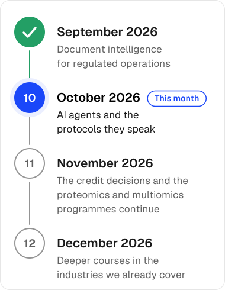</picture></p>

- **September 2026.** Document intelligence for regulated operations, retrieval and RAG, and the agents track begins.
- **October 2026.** AI agents and the protocols they speak, two new industry programmes on proteomics and multiomics and on evidence-based credit decisions, AI for science, serving models on modest hardware, post-training from scratch, and evaluating across languages.
- **November 2026.** The credit decisions and the proteomics and multiomics programmes continue, module by module.
- **December 2026.** Deeper courses in the industries we already cover.

<!-- COMING:END -->

## How a lesson works

Every lesson here is a notebook you *do*, not one you read. You fill in the exercises, and each
one checks itself the moment you run it.

<p align="center">
<picture><source media="(prefers-color-scheme: dark)" srcset="brand/readme/flow-1-open-dark.svg">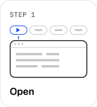</picture>
<picture><source media="(prefers-color-scheme: dark)" srcset="brand/readme/flow-2-run-dark.svg">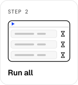</picture>
<picture><source media="(prefers-color-scheme: dark)" srcset="brand/readme/flow-3-fill-dark.svg">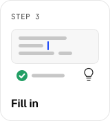</picture>
<picture><source media="(prefers-color-scheme: dark)" srcset="brand/readme/flow-4-board-dark.svg">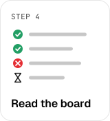</picture>
</p>

1. **Open** it in Colab, Kaggle, Binder, Codespaces or your own Jupyter. The first cell installs
   what the lesson needs at the versions it was measured with, and does nothing where it is
   already there.
2. **Run all** before you write a line. Every cell runs: each unfinished exercise says it is not
   implemented yet, and a progress board ends the notebook, one line per exercise, marked
   ✅ passed, ❌ failed or ⏳ not started.
3. **Fill in** an exercise and re-run its cell. Its check says whether you are right and, if not,
   what the likely mistake is. Each exercise has two hints, the first on what to think about and
   the second on the approach; neither gives you the answer.
4. **Read the board.** Your score against the full rubric, and the worked solution, come with
   enrolment on Synapsa.

Anything a lesson measures on your machine, like a time or a memory peak, prints with its unit and
will differ from ours. Every other number a finished lesson prints is identical on Python 3.11 and
3.12; every lesson is checked for that before it is released.

### Run it anywhere

On Kaggle, a lesson that installs a package or fetches a file needs Internet switched on in the
notebook's settings, and Kaggle allows that only for phone-verified accounts. Colab, Binder and
Codespaces need nothing.

<!-- GEN:codespaces:BEGIN generated by tools/status.py; do not edit -->

Codespaces opens the whole repository, so open the lesson's `lesson.ipynb` yourself once it has started:

<a href="https://codespaces.new/TarrySingh/Artificial-Intelligence-Deep-Learning-Machine-Learning-Tutorials"><picture><source media="(prefers-color-scheme: dark)" srcset="brand/readme/open-codespaces-dark.svg"></picture></a>

<!-- GEN:end -->

To work on your own machine, with Python 3.11 or 3.12:

```sh
git clone --depth 1 \
  https://github.com/TarrySingh/Artificial-Intelligence-Deep-Learning-Machine-Learning-Tutorials \
  synapsa-commons
cd synapsa-commons
python -m venv .venv && .venv/bin/pip install -r requirements.txt
.venv/bin/jupyter lab
```

On Windows the last two commands use `.venv\Scripts\pip` and `.venv\Scripts\jupyter`.

<!-- GEN:compiled:BEGIN generated by tools/status.py; do not edit -->

7 lessons are C or C++ exercises, and they also need `make` and a C or C++ compiler (`clang` or `gcc`). Binder and Codespaces install both from this repository's own setup ([`binder/apt.txt`](binder/apt.txt) and [`.devcontainer/devcontainer.json`](.devcontainer/devcontainer.json)); on your own machine, install them first.

<!-- GEN:end -->

<details><summary>PyTorch, for the few lessons that use it</summary>

PyTorch is an optional, separate install, because only a few lessons use it. Colab and Kaggle
already have it, and a lesson that needs it installs it from its first cell anywhere else. To
install it yourself, run `.venv/bin/pip install -r requirements-torch.txt`; on Linux, add
`--index-url https://download.pytorch.org/whl/cpu` to get the CPU build the lessons are checked
with instead of gigabytes of CUDA libraries. On a Mac the pinned version needs Apple silicon and
macOS 14 or later.

</details>

The [lessons workflow](https://github.com/TarrySingh/Artificial-Intelligence-Deep-Learning-Machine-Learning-Tutorials/actions/workflows/lessons.yml)
checks on Linux, which is what Colab, Kaggle, Binder and Codespaces run, that every notebook
opens and runs.

## The bar every lesson clears

<picture><source media="(prefers-color-scheme: dark)" srcset="brand/readme/seal-dark.svg"></picture>

<!-- GEN:gates:BEGIN generated by tools/status.py; do not edit -->

[`QUALITY.md`](QUALITY.md) sets out 14 gates that a lesson must pass before it is marked built.

<!-- GEN:end -->

A lesson is marked built only after an independent reviewer has tried to break it, including by
grading plausible wrong answers against its rubric.

<br clear="left">

In short, every lesson has:

- measurable objectives, and prerequisites that are real lessons;
- scaffolded exercises with instant feedback, an autograded rubric, a worked solution and a
  self-check;
- a clean run from top to bottom in a fresh interpreter, inside a declared compute tier and time
  budget;
- free data that needs no registration, named with its licence;
- a primary source for every claim about the world, and no measured or computed number typed into
  the prose by hand;
- a notebook that opens and runs alone on Python 3.11 and 3.12, where Run all is a good
  experience.

## Synapsa

<p align="center"><a href="https://synapsa.realai.eu"><picture><source media="(prefers-color-scheme: dark)" srcset="brand/readme/synapsa-invite-dark.svg">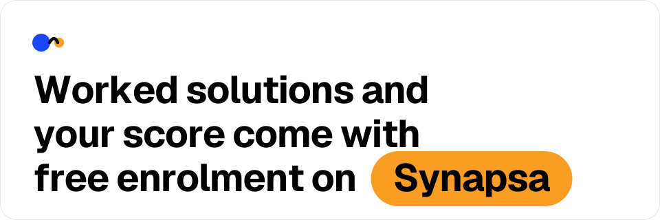</picture></a></p>

<!-- GEN:synapsa:BEGIN generated by tools/status.py; do not edit -->

Worked solutions, the full rubric with partial credit, and an official score come with free enrolment on [Synapsa](https://synapsa.realai.eu). Enrolment has not opened yet.

<!-- GEN:end -->

## The 2017-2025 tutorials

<picture><source media="(prefers-color-scheme: dark)" srcset="brand/readme/archive-dark.svg"></picture>

From 2017 to 2025 this repository carried a curated collection of machine-learning and
deep-learning tutorials, much of it gathered from other people's work. It helped a great many
learners, and we are grateful to everyone who starred it, forked it and contributed to it. That
collection has now been retired from public view, so that everything published here is original
work we can stand behind and license. Synapsa Commons replaces it.

<br clear="left">

## Licence

Synapsa Commons is © 2026 RealAI, free to learn from and share, and licensed under
[CC BY-NC-SA 4.0](https://creativecommons.org/licenses/by-nc-sa/4.0/); the legal code is in
[`LICENSE`](LICENSE) and a plain-words summary in [`NOTICE`](NOTICE).

- **You may** use the lessons to learn and to teach, and copy, fork, share and adapt them.
- **You must** credit "Synapsa Commons by RealAI" with a link here, say what you changed, and
  share adaptations under the same licence.
- **You may not** use them, or anything adapted from them, for commercial advantage or payment:
  selling them, charging for a course or training built on them, or packaging them into a paid
  product or service.

Commercial licences are available from [RealAI](https://www.realai.eu/contact). Third-party
material inside a lesson keeps its own licence, named in that lesson's `assets/SOURCE.md` or
`claims.yaml`. The Synapsa name and logo belong to RealAI and are not licensed.

<details><summary>For maintainers</summary>

- `lessons/`, `flagships/`, `programmes/`: track lessons, flagship subtrees, industry programmes.
- Lessons are written and gated in a separate source that holds the worked solutions and the
  rubrics; this repository receives the student version of each lesson once it passes. The
  status lines, indexes and launch links on these pages are generated there from the lessons
  themselves.
- `tools/notebooks.py` generates each `lesson.ipynb` and its launcher cell (`--check` for drift),
  and `tools/verify_portable.py` runs each notebook alone in a minimal kernel on Python 3.11 and
  3.12. `.github/workflows/lessons.yml` runs both on Linux on every change, and fails if a
  solution or rubric file is ever committed here.
- `brand/` holds the Synapsa Commons lockups used here and at the top of every notebook;
  `brand/readme/` and `brand/areas/` hold the artwork on these pages, and
  `tools/brand_svgs.py --lint` checks it.

</details>

<p align="center"><picture><source media="(prefers-color-scheme: dark)" srcset="brand/readme/mark-dark.svg"></picture><br>Synapsa Commons by RealAI · <a href="https://synapsa.realai.eu">synapsa.realai.eu</a></p>
