<!-- GEN:head:BEGIN generated by tools/status.py; do not edit -->

[Synapsa Commons](../README.md) › Track lessons

<!-- GEN:end -->

# Track lessons

Lessons that belong to a subject track rather than to one industry programme. Each is a notebook
you do, with the same exercises, checks and hints as every other lesson here, and each opens in
Colab, Kaggle or Binder from the links beside it, or in Codespaces or your own Jupyter as
[the README](../README.md#run-it-anywhere) describes; the worked solution and the full rubric come
with enrolment on Synapsa.

<!-- GEN:tracks:BEGIN generated by tools/status.py; do not edit -->

New here? Take [the beginner path](#start-from-zero), or pick a track.

<a href="README.md#orientation"><picture><source media="(prefers-color-scheme: dark)" srcset="../brand/areas/t00-tile-dark.svg">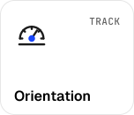</picture></a>
<a href="README.md#data-and-statistics"><picture><source media="(prefers-color-scheme: dark)" srcset="../brand/areas/t01-tile-dark.svg">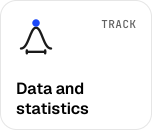</picture></a>
<a href="README.md#deep-learning-foundations"><picture><source media="(prefers-color-scheme: dark)" srcset="../brand/areas/t02-tile-dark.svg">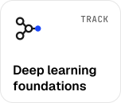</picture></a>
<a href="README.md#language-models"><picture><source media="(prefers-color-scheme: dark)" srcset="../brand/areas/t03-tile-dark.svg">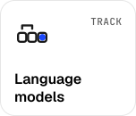</picture></a> 
<a href="README.md#post-training"><picture><source media="(prefers-color-scheme: dark)" srcset="../brand/areas/t04-tile-dark.svg">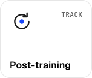</picture></a>
<a href="README.md#inference-systems"><picture><source media="(prefers-color-scheme: dark)" srcset="../brand/areas/t05-tile-dark.svg">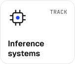</picture></a>
<a href="README.md#retrieval-and-rag"><picture><source media="(prefers-color-scheme: dark)" srcset="../brand/areas/t06-tile-dark.svg">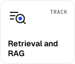</picture></a>
<a href="README.md#agents-and-protocols"><picture><source media="(prefers-color-scheme: dark)" srcset="../brand/areas/t07-tile-dark.svg">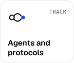</picture></a> 
<a href="README.md#ai-engineering"><picture><source media="(prefers-color-scheme: dark)" srcset="../brand/areas/t08-tile-dark.svg">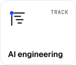</picture></a>
<a href="README.md#evaluation-and-governance"><picture><source media="(prefers-color-scheme: dark)" srcset="../brand/areas/t10-tile-dark.svg">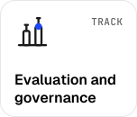</picture></a>
<a href="README.md#ai-for-science"><picture><source media="(prefers-color-scheme: dark)" srcset="../brand/areas/t12-tile-dark.svg">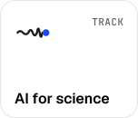</picture></a>

## Start from zero

Begin with some Python and take these in order; each needs only the lessons before it.

1. **[The 8 GB track](T00-L01-the-8gb-track/lesson.ipynb)** · ~40 minutes · Python · no lesson to do first 
   Build a profiler that measures what any piece of Python really costs in time and memory, rank four implementations of one task on the numbers, and reproduce the compute-tier check every lesson here has to pass. 
    <a href="https://kaggle.com/kernels/welcome?src=https://github.com/TarrySingh/Artificial-Intelligence-Deep-Learning-Machine-Learning-Tutorials/blob/master/lessons/T00-L01-the-8gb-track/lesson.ipynb"><picture><source media="(prefers-color-scheme: dark)" srcset="../brand/readme/open-kaggle-dark.svg"></picture></a> <a href="https://mybinder.org/v2/gh/TarrySingh/Artificial-Intelligence-Deep-Learning-Machine-Learning-Tutorials/master?labpath=lessons/T00-L01-the-8gb-track/lesson.ipynb"><picture><source media="(prefers-color-scheme: dark)" srcset="../brand/readme/open-binder-dark.svg"></picture></a>
2. **[Byte-level BPE from scratch](T03-L01-bpe-from-scratch/lesson.ipynb)** · ~60 minutes · Python · builds on [The 8 GB track](T00-L01-the-8gb-track/lesson.ipynb) 
   Build byte-level byte pair encoding from scratch, and measure the token tax it imposes on five writing systems. 
    <a href="https://kaggle.com/kernels/welcome?src=https://github.com/TarrySingh/Artificial-Intelligence-Deep-Learning-Machine-Learning-Tutorials/blob/master/lessons/T03-L01-bpe-from-scratch/lesson.ipynb"><picture><source media="(prefers-color-scheme: dark)" srcset="../brand/readme/open-kaggle-dark.svg"></picture></a> <a href="https://mybinder.org/v2/gh/TarrySingh/Artificial-Intelligence-Deep-Learning-Machine-Learning-Tutorials/master?labpath=lessons/T03-L01-bpe-from-scratch/lesson.ipynb"><picture><source media="(prefers-color-scheme: dark)" srcset="../brand/readme/open-binder-dark.svg"></picture></a>
3. **[The CPU slice of nanolm](T03-L03-nanolm-cpu-slice/lesson.ipynb)** · ~75 minutes · Python · builds on [The 8 GB track](T00-L01-the-8gb-track/lesson.ipynb) 
   Train a character-level language model on a CPU with numpy alone, its backward pass derived by hand and checked against finite differences. 
    <a href="https://kaggle.com/kernels/welcome?src=https://github.com/TarrySingh/Artificial-Intelligence-Deep-Learning-Machine-Learning-Tutorials/blob/master/lessons/T03-L03-nanolm-cpu-slice/lesson.ipynb"><picture><source media="(prefers-color-scheme: dark)" srcset="../brand/readme/open-kaggle-dark.svg"></picture></a> <a href="https://mybinder.org/v2/gh/TarrySingh/Artificial-Intelligence-Deep-Learning-Machine-Learning-Tutorials/master?labpath=lessons/T03-L03-nanolm-cpu-slice/lesson.ipynb"><picture><source media="(prefers-color-scheme: dark)" srcset="../brand/readme/open-binder-dark.svg"></picture></a>
4. **[Retrieval from scratch](T06-L01-retrieval-from-scratch/lesson.ipynb)** · ~70 minutes · Python · builds on [The 8 GB track](T00-L01-the-8gb-track/lesson.ipynb) 
   Build BM25, a dense retriever with no external model and hybrid fusion, scored by an evaluation harness whose intervals say when one retriever is really better. 
    <a href="https://kaggle.com/kernels/welcome?src=https://github.com/TarrySingh/Artificial-Intelligence-Deep-Learning-Machine-Learning-Tutorials/blob/master/lessons/T06-L01-retrieval-from-scratch/lesson.ipynb"><picture><source media="(prefers-color-scheme: dark)" srcset="../brand/readme/open-kaggle-dark.svg"></picture></a> <a href="https://mybinder.org/v2/gh/TarrySingh/Artificial-Intelligence-Deep-Learning-Machine-Learning-Tutorials/master?labpath=lessons/T06-L01-retrieval-from-scratch/lesson.ipynb"><picture><source media="(prefers-color-scheme: dark)" srcset="../brand/readme/open-binder-dark.svg"></picture></a>
5. **[The agent loop from scratch](T07-L01-agent-loop-from-scratch/lesson.ipynb)** · ~55 minutes · Python · builds on [The 8 GB track](T00-L01-the-8gb-track/lesson.ipynb) 
   Build an agent harness with validated tools, budgets, retries and traces, and measure how per-step reliability compounds over long tasks. 
    <a href="https://kaggle.com/kernels/welcome?src=https://github.com/TarrySingh/Artificial-Intelligence-Deep-Learning-Machine-Learning-Tutorials/blob/master/lessons/T07-L01-agent-loop-from-scratch/lesson.ipynb"><picture><source media="(prefers-color-scheme: dark)" srcset="../brand/readme/open-kaggle-dark.svg"></picture></a> <a href="https://mybinder.org/v2/gh/TarrySingh/Artificial-Intelligence-Deep-Learning-Machine-Learning-Tutorials/master?labpath=lessons/T07-L01-agent-loop-from-scratch/lesson.ipynb"><picture><source media="(prefers-color-scheme: dark)" srcset="../brand/readme/open-binder-dark.svg"></picture></a>

## Orientation

<picture><source media="(prefers-color-scheme: dark)" srcset="../brand/areas/t00-icon-dark.svg"></picture> **3 lessons**

Start from nothing, on a laptop. Measure what code costs on an 8 GB machine, keep a model registry honest through a model swap, and write one client for three backends.

- **[The 8 GB track](T00-L01-the-8gb-track/lesson.ipynb)** · ~40 minutes · Python · no lesson to do first 
  Build a profiler that measures what any piece of Python really costs in time and memory, rank four implementations of one task on the numbers, and reproduce the compute-tier check every lesson here has to pass. 
   <a href="https://kaggle.com/kernels/welcome?src=https://github.com/TarrySingh/Artificial-Intelligence-Deep-Learning-Machine-Learning-Tutorials/blob/master/lessons/T00-L01-the-8gb-track/lesson.ipynb"><picture><source media="(prefers-color-scheme: dark)" srcset="../brand/readme/open-kaggle-dark.svg"></picture></a> <a href="https://mybinder.org/v2/gh/TarrySingh/Artificial-Intelligence-Deep-Learning-Machine-Learning-Tutorials/master?labpath=lessons/T00-L01-the-8gb-track/lesson.ipynb"><picture><source media="(prefers-color-scheme: dark)" srcset="../brand/readme/open-binder-dark.svg"></picture></a>
- **[A model registry that survives a swap](T00-L02-model-registry/lesson.ipynb)** · ~40 minutes · Python · builds on [The 8 GB track](T00-L01-the-8gb-track/lesson.ipynb) 
  Build a role-based model registry, a retirement detector run against a dated snapshot of a provider's model pages, and a golden test that survives a model swap. 
   <a href="https://kaggle.com/kernels/welcome?src=https://github.com/TarrySingh/Artificial-Intelligence-Deep-Learning-Machine-Learning-Tutorials/blob/master/lessons/T00-L02-model-registry/lesson.ipynb"><picture><source media="(prefers-color-scheme: dark)" srcset="../brand/readme/open-kaggle-dark.svg"></picture></a> <a href="https://mybinder.org/v2/gh/TarrySingh/Artificial-Intelligence-Deep-Learning-Machine-Learning-Tutorials/master?labpath=lessons/T00-L02-model-registry/lesson.ipynb"><picture><source media="(prefers-color-scheme: dark)" srcset="../brand/readme/open-binder-dark.svg"></picture></a>
- **[One client, three backends](T00-L03-one-client-three-backends/lesson.ipynb)** · ~50 minutes · Python · builds on [The 8 GB track](T00-L01-the-8gb-track/lesson.ipynb) 
  Build the normalising half of a provider-agnostic LLM client, which reads tool calls, reasoning and JSON out of whatever shape a backend returns, and a compatibility suite that shows what three stand-in backends keep, rename, drop or reject. 
   <a href="https://kaggle.com/kernels/welcome?src=https://github.com/TarrySingh/Artificial-Intelligence-Deep-Learning-Machine-Learning-Tutorials/blob/master/lessons/T00-L03-one-client-three-backends/lesson.ipynb"><picture><source media="(prefers-color-scheme: dark)" srcset="../brand/readme/open-kaggle-dark.svg"></picture></a> <a href="https://mybinder.org/v2/gh/TarrySingh/Artificial-Intelligence-Deep-Learning-Machine-Learning-Tutorials/master?labpath=lessons/T00-L03-one-client-three-backends/lesson.ipynb"><picture><source media="(prefers-color-scheme: dark)" srcset="../brand/readme/open-binder-dark.svg"></picture></a>

## Data and statistics

<picture><source media="(prefers-color-scheme: dark)" srcset="../brand/areas/t01-icon-dark.svg"></picture> **2 lessons**

Statistics by simulation: sampling distributions, bootstrap intervals, permutation tests and power, the habits every later lesson leans on.

- **[Statistics by simulation](T01-L01-statistics-by-simulation/lesson.ipynb)** · ~90 minutes · Python · builds on [The 8 GB track](T00-L01-the-8gb-track/lesson.ipynb) 
  Build a simulation toolkit for experiment analysis -- sampling distributions, bootstrap intervals, a permutation test and power calculator -- and audit how peeking and testing twenty metrics inflate false positives 
   <a href="https://kaggle.com/kernels/welcome?src=https://github.com/TarrySingh/Artificial-Intelligence-Deep-Learning-Machine-Learning-Tutorials/blob/master/lessons/T01-L01-statistics-by-simulation/lesson.ipynb"><picture><source media="(prefers-color-scheme: dark)" srcset="../brand/readme/open-kaggle-dark.svg"></picture></a> <a href="https://mybinder.org/v2/gh/TarrySingh/Artificial-Intelligence-Deep-Learning-Machine-Learning-Tutorials/master?labpath=lessons/T01-L01-statistics-by-simulation/lesson.ipynb"><picture><source media="(prefers-color-scheme: dark)" srcset="../brand/readme/open-binder-dark.svg"></picture></a>
- **[How models lie](T01-L02-leakage-clinic/lesson.ipynb)** · ~50 minutes · Python · builds on [The 8 GB track](T00-L01-the-8gb-track/lesson.ipynb) and [Statistics by simulation](T01-L01-statistics-by-simulation/lesson.ipynb) 
  Build a leakage clinic — plant five leaks (target, preprocessing, duplicate, group and temporal) in a seeded customer book, measure how much each inflates cross-validated AUC against an oracle ceiling, and write the split, feature and pipeline checks that catch all five 
   <a href="https://kaggle.com/kernels/welcome?src=https://github.com/TarrySingh/Artificial-Intelligence-Deep-Learning-Machine-Learning-Tutorials/blob/master/lessons/T01-L02-leakage-clinic/lesson.ipynb"><picture><source media="(prefers-color-scheme: dark)" srcset="../brand/readme/open-kaggle-dark.svg"></picture></a> <a href="https://mybinder.org/v2/gh/TarrySingh/Artificial-Intelligence-Deep-Learning-Machine-Learning-Tutorials/master?labpath=lessons/T01-L02-leakage-clinic/lesson.ipynb"><picture><source media="(prefers-color-scheme: dark)" srcset="../brand/readme/open-binder-dark.svg"></picture></a>

## Deep learning foundations

<picture><source media="(prefers-color-scheme: dark)" srcset="../brand/areas/t02-icon-dark.svg"></picture> **1 lesson**

Build automatic differentiation from scratch, a scalar engine and a tensor engine, and the gradient check that keeps both honest.

- **[Autodiff from scratch](T02-L01-autograd-from-scratch/lesson.ipynb)** · ~75 minutes · Python · builds on [The 8 GB track](T00-L01-the-8gb-track/lesson.ipynb) 
  Build a scalar and a tensor reverse-mode autodiff engine, plus a forward-mode one, and hold every gradient to a finite-difference check 
   <a href="https://kaggle.com/kernels/welcome?src=https://github.com/TarrySingh/Artificial-Intelligence-Deep-Learning-Machine-Learning-Tutorials/blob/master/lessons/T02-L01-autograd-from-scratch/lesson.ipynb"><picture><source media="(prefers-color-scheme: dark)" srcset="../brand/readme/open-kaggle-dark.svg"></picture></a> <a href="https://mybinder.org/v2/gh/TarrySingh/Artificial-Intelligence-Deep-Learning-Machine-Learning-Tutorials/master?labpath=lessons/T02-L01-autograd-from-scratch/lesson.ipynb"><picture><source media="(prefers-color-scheme: dark)" srcset="../brand/readme/open-binder-dark.svg"></picture></a>

## Language models

<picture><source media="(prefers-color-scheme: dark)" srcset="../brand/areas/t03-icon-dark.svg"></picture> **3 lessons**

Tokenisers from scratch, the BPE merge loop in C++, and a language model trained on a CPU with numpy alone.

- **[Byte-level BPE from scratch](T03-L01-bpe-from-scratch/lesson.ipynb)** · ~60 minutes · Python · builds on [The 8 GB track](T00-L01-the-8gb-track/lesson.ipynb) 
  Build byte-level byte pair encoding from scratch, and measure the token tax it imposes on five writing systems. 
   <a href="https://kaggle.com/kernels/welcome?src=https://github.com/TarrySingh/Artificial-Intelligence-Deep-Learning-Machine-Learning-Tutorials/blob/master/lessons/T03-L01-bpe-from-scratch/lesson.ipynb"><picture><source media="(prefers-color-scheme: dark)" srcset="../brand/readme/open-kaggle-dark.svg"></picture></a> <a href="https://mybinder.org/v2/gh/TarrySingh/Artificial-Intelligence-Deep-Learning-Machine-Learning-Tutorials/master?labpath=lessons/T03-L01-bpe-from-scratch/lesson.ipynb"><picture><source media="(prefers-color-scheme: dark)" srcset="../brand/readme/open-binder-dark.svg"></picture></a>
- **[The BPE merge loop, in C++](T03-L02-bpe-merge-loop-in-cpp/lesson.ipynb)** · ~60 minutes · C++ · builds on [Byte-level BPE from scratch](T03-L01-bpe-from-scratch/lesson.ipynb) 
  Write the BPE merge loop in C++, and measure its speed-up over the Python trainer on one identical corpus. 
   <a href="https://kaggle.com/kernels/welcome?src=https://github.com/TarrySingh/Artificial-Intelligence-Deep-Learning-Machine-Learning-Tutorials/blob/master/lessons/T03-L02-bpe-merge-loop-in-cpp/lesson.ipynb"><picture><source media="(prefers-color-scheme: dark)" srcset="../brand/readme/open-kaggle-dark.svg"></picture></a> <a href="https://mybinder.org/v2/gh/TarrySingh/Artificial-Intelligence-Deep-Learning-Machine-Learning-Tutorials/master?labpath=lessons/T03-L02-bpe-merge-loop-in-cpp/lesson.ipynb"><picture><source media="(prefers-color-scheme: dark)" srcset="../brand/readme/open-binder-dark.svg"></picture></a>
- **[The CPU slice of nanolm](T03-L03-nanolm-cpu-slice/lesson.ipynb)** · ~75 minutes · Python · builds on [The 8 GB track](T00-L01-the-8gb-track/lesson.ipynb) 
  Train a character-level language model on a CPU with numpy alone, its backward pass derived by hand and checked against finite differences. 
   <a href="https://kaggle.com/kernels/welcome?src=https://github.com/TarrySingh/Artificial-Intelligence-Deep-Learning-Machine-Learning-Tutorials/blob/master/lessons/T03-L03-nanolm-cpu-slice/lesson.ipynb"><picture><source media="(prefers-color-scheme: dark)" srcset="../brand/readme/open-kaggle-dark.svg"></picture></a> <a href="https://mybinder.org/v2/gh/TarrySingh/Artificial-Intelligence-Deep-Learning-Machine-Learning-Tutorials/master?labpath=lessons/T03-L03-nanolm-cpu-slice/lesson.ipynb"><picture><source media="(prefers-color-scheme: dark)" srcset="../brand/readme/open-binder-dark.svg"></picture></a>

## Post-training

<picture><source media="(prefers-color-scheme: dark)" srcset="../brand/areas/t04-icon-dark.svg"></picture> **3 lessons**

Post-training from scratch: GRPO in numpy on a tiny model, and the traps that make a reward mislead you, measured.

- **[GRPO from scratch on a tiny model](T04-L01-grpo-from-scratch/lesson.ipynb)** · ~60 minutes · Python · builds on [The 8 GB track](T00-L01-the-8gb-track/lesson.ipynb) 
  Build GRPO from scratch in numpy on a tiny model, and measure its traps: zero-variance groups, length and standard-deviation normalisation, group size and a reward hack. 
   <a href="https://kaggle.com/kernels/welcome?src=https://github.com/TarrySingh/Artificial-Intelligence-Deep-Learning-Machine-Learning-Tutorials/blob/master/lessons/T04-L01-grpo-from-scratch/lesson.ipynb"><picture><source media="(prefers-color-scheme: dark)" srcset="../brand/readme/open-kaggle-dark.svg"></picture></a> <a href="https://mybinder.org/v2/gh/TarrySingh/Artificial-Intelligence-Deep-Learning-Machine-Learning-Tutorials/master?labpath=lessons/T04-L01-grpo-from-scratch/lesson.ipynb"><picture><source media="(prefers-color-scheme: dark)" srcset="../brand/readme/open-binder-dark.svg"></picture></a>
- **[Chat templates and loss masking](T04-L02-chat-templates-and-masking/lesson.ipynb)** · ~90 minutes · Python · builds on [Byte-level BPE from scratch](T03-L01-bpe-from-scratch/lesson.ipynb) and [The CPU slice of nanolm](T03-L03-nanolm-cpu-slice/lesson.ipynb) 
  Plant five chat-template, loss-masking, end-token and packing bugs in a numpy fine-tuning pipeline, measure what each does to held-out behaviour, and write the five tests that catch them before training starts 
   <a href="https://kaggle.com/kernels/welcome?src=https://github.com/TarrySingh/Artificial-Intelligence-Deep-Learning-Machine-Learning-Tutorials/blob/master/lessons/T04-L02-chat-templates-and-masking/lesson.ipynb"><picture><source media="(prefers-color-scheme: dark)" srcset="../brand/readme/open-kaggle-dark.svg"></picture></a> <a href="https://mybinder.org/v2/gh/TarrySingh/Artificial-Intelligence-Deep-Learning-Machine-Learning-Tutorials/master?labpath=lessons/T04-L02-chat-templates-and-masking/lesson.ipynb"><picture><source media="(prefers-color-scheme: dark)" srcset="../brand/readme/open-binder-dark.svg"></picture></a>
- **[Build a cost and quality decision calculator that prices prompting, retrieval, fine-tuning, distillation and a mix over a year, and finds the volumes at which each overtakes the last](T04-L03-cost-and-quality-decision-calculator/lesson.ipynb)** · ~45 minutes · Python · builds on [The 8 GB track](T00-L01-the-8gb-track/lesson.ipynb) 
  Build a cost and quality decision calculator that prices prompting, retrieval, fine-tuning, distillation and a mix over a year in three currencies and finds the volumes at which each overtakes the last 
   <a href="https://kaggle.com/kernels/welcome?src=https://github.com/TarrySingh/Artificial-Intelligence-Deep-Learning-Machine-Learning-Tutorials/blob/master/lessons/T04-L03-cost-and-quality-decision-calculator/lesson.ipynb"><picture><source media="(prefers-color-scheme: dark)" srcset="../brand/readme/open-kaggle-dark.svg"></picture></a> <a href="https://mybinder.org/v2/gh/TarrySingh/Artificial-Intelligence-Deep-Learning-Machine-Learning-Tutorials/master?labpath=lessons/T04-L03-cost-and-quality-decision-calculator/lesson.ipynb"><picture><source media="(prefers-color-scheme: dark)" srcset="../brand/readme/open-binder-dark.svg"></picture></a>

## Inference systems

<picture><source media="(prefers-color-scheme: dark)" srcset="../brand/areas/t05-icon-dark.svg"></picture> **2 lessons**

Serve a language model on modest hardware: a KV cache, paging and continuous batching on a CPU, and what each one buys.

- **[Serving a small model on a CPU](T05-L01-serving-on-a-cpu/lesson.ipynb)** · ~90 minutes · Python · builds on [The 8 GB track](T00-L01-the-8gb-track/lesson.ipynb) and [The CPU slice of nanolm](T03-L03-nanolm-cpu-slice/lesson.ipynb) 
  Serve a small transformer on a CPU the way an inference engine does, with a KV cache and static batching, and account for the operations, memory and latency each one buys. 
   <a href="https://kaggle.com/kernels/welcome?src=https://github.com/TarrySingh/Artificial-Intelligence-Deep-Learning-Machine-Learning-Tutorials/blob/master/lessons/T05-L01-serving-on-a-cpu/lesson.ipynb"><picture><source media="(prefers-color-scheme: dark)" srcset="../brand/readme/open-kaggle-dark.svg"></picture></a> <a href="https://mybinder.org/v2/gh/TarrySingh/Artificial-Intelligence-Deep-Learning-Machine-Learning-Tutorials/master?labpath=lessons/T05-L01-serving-on-a-cpu/lesson.ipynb"><picture><source media="(prefers-color-scheme: dark)" srcset="../brand/readme/open-binder-dark.svg"></picture></a>
- **[nanoserve, part two](T05-L02-paged-kv-and-continuous-batching/lesson.ipynb)** · ~2 hours · Python · builds on [The CPU slice of nanolm](T03-L03-nanolm-cpu-slice/lesson.ipynb) and [Serving a small model on a CPU](T05-L01-serving-on-a-cpu/lesson.ipynb) 
  Build a paged KV cache and a continuous-batching scheduler for a small language model, prove that they change no token, and measure what they buy against a contiguous cache with static batching. 
   <a href="https://kaggle.com/kernels/welcome?src=https://github.com/TarrySingh/Artificial-Intelligence-Deep-Learning-Machine-Learning-Tutorials/blob/master/lessons/T05-L02-paged-kv-and-continuous-batching/lesson.ipynb"><picture><source media="(prefers-color-scheme: dark)" srcset="../brand/readme/open-kaggle-dark.svg"></picture></a> <a href="https://mybinder.org/v2/gh/TarrySingh/Artificial-Intelligence-Deep-Learning-Machine-Learning-Tutorials/master?labpath=lessons/T05-L02-paged-kv-and-continuous-batching/lesson.ipynb"><picture><source media="(prefers-color-scheme: dark)" srcset="../brand/readme/open-binder-dark.svg"></picture></a>

## Retrieval and RAG

<picture><source media="(prefers-color-scheme: dark)" srcset="../brand/areas/t06-icon-dark.svg"></picture> **4 lessons**

Build search and RAG you can measure: retrieval, chunking, the context budget, reranking and agent memory.

- **[Retrieval from scratch](T06-L01-retrieval-from-scratch/lesson.ipynb)** · ~70 minutes · Python · builds on [The 8 GB track](T00-L01-the-8gb-track/lesson.ipynb) 
  Build BM25, a dense retriever with no external model and hybrid fusion, scored by an evaluation harness whose intervals say when one retriever is really better. 
   <a href="https://kaggle.com/kernels/welcome?src=https://github.com/TarrySingh/Artificial-Intelligence-Deep-Learning-Machine-Learning-Tutorials/blob/master/lessons/T06-L01-retrieval-from-scratch/lesson.ipynb"><picture><source media="(prefers-color-scheme: dark)" srcset="../brand/readme/open-kaggle-dark.svg"></picture></a> <a href="https://mybinder.org/v2/gh/TarrySingh/Artificial-Intelligence-Deep-Learning-Machine-Learning-Tutorials/master?labpath=lessons/T06-L01-retrieval-from-scratch/lesson.ipynb"><picture><source media="(prefers-color-scheme: dark)" srcset="../brand/readme/open-binder-dark.svg"></picture></a>
- **[Chunking and the context budget](T06-L02-chunking-and-context-budget/lesson.ipynb)** · ~55 minutes · Python · builds on [The 8 GB track](T00-L01-the-8gb-track/lesson.ipynb) and [Retrieval from scratch](T06-L01-retrieval-from-scratch/lesson.ipynb) 
  Chunk documents and assemble context under a token budget, measured by whether the evidence an answer needs actually reaches the model. 
   <a href="https://kaggle.com/kernels/welcome?src=https://github.com/TarrySingh/Artificial-Intelligence-Deep-Learning-Machine-Learning-Tutorials/blob/master/lessons/T06-L02-chunking-and-context-budget/lesson.ipynb"><picture><source media="(prefers-color-scheme: dark)" srcset="../brand/readme/open-kaggle-dark.svg"></picture></a> <a href="https://mybinder.org/v2/gh/TarrySingh/Artificial-Intelligence-Deep-Learning-Machine-Learning-Tutorials/master?labpath=lessons/T06-L02-chunking-and-context-budget/lesson.ipynb"><picture><source media="(prefers-color-scheme: dark)" srcset="../brand/readme/open-binder-dark.svg"></picture></a>
- **[Reranking, and what it costs](T06-L03-reranking-measured/lesson.ipynb)** · ~75 minutes · Python · builds on [The 8 GB track](T00-L01-the-8gb-track/lesson.ipynb), [Retrieval from scratch](T06-L01-retrieval-from-scratch/lesson.ipynb) and [Chunking and the context budget](T06-L02-chunking-and-context-budget/lesson.ipynb) 
  Build a learned reranker, pointwise and pairwise, state its gain with its interval, measure what reranking depth costs, and meet the trap of tuning on test queries. 
   <a href="https://kaggle.com/kernels/welcome?src=https://github.com/TarrySingh/Artificial-Intelligence-Deep-Learning-Machine-Learning-Tutorials/blob/master/lessons/T06-L03-reranking-measured/lesson.ipynb"><picture><source media="(prefers-color-scheme: dark)" srcset="../brand/readme/open-kaggle-dark.svg"></picture></a> <a href="https://mybinder.org/v2/gh/TarrySingh/Artificial-Intelligence-Deep-Learning-Machine-Learning-Tutorials/master?labpath=lessons/T06-L03-reranking-measured/lesson.ipynb"><picture><source media="(prefers-color-scheme: dark)" srcset="../brand/readme/open-binder-dark.svg"></picture></a>
- **[Agent memory](T06-L04-agent-memory/lesson.ipynb)** · ~45 minutes · Python · builds on [The 8 GB track](T00-L01-the-8gb-track/lesson.ipynb), [Retrieval from scratch](T06-L01-retrieval-from-scratch/lesson.ipynb) and [The agent loop from scratch](T07-L01-agent-loop-from-scratch/lesson.ipynb) 
  Build memory for a long-running assistant: what to store, how recency, importance and relevance combine at retrieval, and why an updated fact must beat the stale one. 
   <a href="https://kaggle.com/kernels/welcome?src=https://github.com/TarrySingh/Artificial-Intelligence-Deep-Learning-Machine-Learning-Tutorials/blob/master/lessons/T06-L04-agent-memory/lesson.ipynb"><picture><source media="(prefers-color-scheme: dark)" srcset="../brand/readme/open-kaggle-dark.svg"></picture></a> <a href="https://mybinder.org/v2/gh/TarrySingh/Artificial-Intelligence-Deep-Learning-Machine-Learning-Tutorials/master?labpath=lessons/T06-L04-agent-memory/lesson.ipynb"><picture><source media="(prefers-color-scheme: dark)" srcset="../brand/readme/open-binder-dark.svg"></picture></a>

## Agents and protocols

<picture><source media="(prefers-color-scheme: dark)" srcset="../brand/areas/t07-icon-dark.svg"></picture> **6 lessons**

Build AI agents that hold up: the agent loop from scratch, MCP and A2A from the wire up, evaluation with intervals, and constrained decoding.

- **[The agent loop from scratch](T07-L01-agent-loop-from-scratch/lesson.ipynb)** · ~55 minutes · Python · builds on [The 8 GB track](T00-L01-the-8gb-track/lesson.ipynb) 
  Build an agent harness with validated tools, budgets, retries and traces, and measure how per-step reliability compounds over long tasks. 
   <a href="https://kaggle.com/kernels/welcome?src=https://github.com/TarrySingh/Artificial-Intelligence-Deep-Learning-Machine-Learning-Tutorials/blob/master/lessons/T07-L01-agent-loop-from-scratch/lesson.ipynb"><picture><source media="(prefers-color-scheme: dark)" srcset="../brand/readme/open-kaggle-dark.svg"></picture></a> <a href="https://mybinder.org/v2/gh/TarrySingh/Artificial-Intelligence-Deep-Learning-Machine-Learning-Tutorials/master?labpath=lessons/T07-L01-agent-loop-from-scratch/lesson.ipynb"><picture><source media="(prefers-color-scheme: dark)" srcset="../brand/readme/open-binder-dark.svg"></picture></a>
- **[The Model Context Protocol, from the wire up](T07-L02-mcp-from-the-wire-up/lesson.ipynb)** · ~50 minutes · Python · builds on [The 8 GB track](T00-L01-the-8gb-track/lesson.ipynb) and [The agent loop from scratch](T07-L01-agent-loop-from-scratch/lesson.ipynb) 
  Build a Model Context Protocol server and client from the specification, checked by a conformance harness built from the same specification. 
   <a href="https://kaggle.com/kernels/welcome?src=https://github.com/TarrySingh/Artificial-Intelligence-Deep-Learning-Machine-Learning-Tutorials/blob/master/lessons/T07-L02-mcp-from-the-wire-up/lesson.ipynb"><picture><source media="(prefers-color-scheme: dark)" srcset="../brand/readme/open-kaggle-dark.svg"></picture></a> <a href="https://mybinder.org/v2/gh/TarrySingh/Artificial-Intelligence-Deep-Learning-Machine-Learning-Tutorials/master?labpath=lessons/T07-L02-mcp-from-the-wire-up/lesson.ipynb"><picture><source media="(prefers-color-scheme: dark)" srcset="../brand/readme/open-binder-dark.svg"></picture></a>
- **[Evaluating agents](T07-L03-evaluating-agents/lesson.ipynb)** · ~50 minutes · Python · builds on [The 8 GB track](T00-L01-the-8gb-track/lesson.ipynb) and [The agent loop from scratch](T07-L01-agent-loop-from-scratch/lesson.ipynb) 
  Evaluate agents with numbers that carry intervals: pass^k against pass@k, trajectory metrics, a failure taxonomy from traces, and a paired comparison of two configurations. 
   <a href="https://kaggle.com/kernels/welcome?src=https://github.com/TarrySingh/Artificial-Intelligence-Deep-Learning-Machine-Learning-Tutorials/blob/master/lessons/T07-L03-evaluating-agents/lesson.ipynb"><picture><source media="(prefers-color-scheme: dark)" srcset="../brand/readme/open-kaggle-dark.svg"></picture></a> <a href="https://mybinder.org/v2/gh/TarrySingh/Artificial-Intelligence-Deep-Learning-Machine-Learning-Tutorials/master?labpath=lessons/T07-L03-evaluating-agents/lesson.ipynb"><picture><source media="(prefers-color-scheme: dark)" srcset="../brand/readme/open-binder-dark.svg"></picture></a>
- **[The Agent2Agent (A2A) protocol, from the wire up](T07-L04-agent-to-agent-a2a/lesson.ipynb)** · ~75 minutes · Python · builds on [The 8 GB track](T00-L01-the-8gb-track/lesson.ipynb), [The agent loop from scratch](T07-L01-agent-loop-from-scratch/lesson.ipynb) and [The Model Context Protocol, from the wire up](T07-L02-mcp-from-the-wire-up/lesson.ipynb) 
  Build an Agent2Agent (A2A) Agent Card validator, task-lifecycle server and streaming client from the specification, checked by a conformance harness built from the same specification. 
   <a href="https://kaggle.com/kernels/welcome?src=https://github.com/TarrySingh/Artificial-Intelligence-Deep-Learning-Machine-Learning-Tutorials/blob/master/lessons/T07-L04-agent-to-agent-a2a/lesson.ipynb"><picture><source media="(prefers-color-scheme: dark)" srcset="../brand/readme/open-kaggle-dark.svg"></picture></a> <a href="https://mybinder.org/v2/gh/TarrySingh/Artificial-Intelligence-Deep-Learning-Machine-Learning-Tutorials/master?labpath=lessons/T07-L04-agent-to-agent-a2a/lesson.ipynb"><picture><source media="(prefers-color-scheme: dark)" srcset="../brand/readme/open-binder-dark.svg"></picture></a>
- **[Constrained decoding from scratch](T07-L05-constrained-decoding/lesson.ipynb)** · ~45 minutes · Python · builds on [Byte-level BPE from scratch](T03-L01-bpe-from-scratch/lesson.ipynb) and [The agent loop from scratch](T07-L01-agent-loop-from-scratch/lesson.ipynb) 
  Build a JSON-schema constrained decoder, a token mask over a BPE vocabulary, and measure what the mask does to the output distribution. 
   <a href="https://kaggle.com/kernels/welcome?src=https://github.com/TarrySingh/Artificial-Intelligence-Deep-Learning-Machine-Learning-Tutorials/blob/master/lessons/T07-L05-constrained-decoding/lesson.ipynb"><picture><source media="(prefers-color-scheme: dark)" srcset="../brand/readme/open-kaggle-dark.svg"></picture></a> <a href="https://mybinder.org/v2/gh/TarrySingh/Artificial-Intelligence-Deep-Learning-Machine-Learning-Tutorials/master?labpath=lessons/T07-L05-constrained-decoding/lesson.ipynb"><picture><source media="(prefers-color-scheme: dark)" srcset="../brand/readme/open-binder-dark.svg"></picture></a>
- **[Build an Agent Client Protocol agent's session lifecycle and drive it from three toy editors](T07-L06-agent-client-protocol/lesson.ipynb)** · ~50 minutes · Python · builds on [The Model Context Protocol, from the wire up](T07-L02-mcp-from-the-wire-up/lesson.ipynb) 
  Build an Agent Client Protocol agent's session lifecycle over JSON-RPC and drive it from three toy editors 
   <a href="https://kaggle.com/kernels/welcome?src=https://github.com/TarrySingh/Artificial-Intelligence-Deep-Learning-Machine-Learning-Tutorials/blob/master/lessons/T07-L06-agent-client-protocol/lesson.ipynb"><picture><source media="(prefers-color-scheme: dark)" srcset="../brand/readme/open-kaggle-dark.svg"></picture></a> <a href="https://mybinder.org/v2/gh/TarrySingh/Artificial-Intelligence-Deep-Learning-Machine-Learning-Tutorials/master?labpath=lessons/T07-L06-agent-client-protocol/lesson.ipynb"><picture><source media="(prefers-color-scheme: dark)" srcset="../brand/readme/open-binder-dark.svg"></picture></a>

## AI engineering

<picture><source media="(prefers-color-scheme: dark)" srcset="../brand/areas/t08-icon-dark.svg"></picture> **2 lessons**

Run agents like production software, with OpenTelemetry traces and a cost-per-task report rebuilt from the traces alone.

- **[Observability for agents](T08-L01-agent-observability/lesson.ipynb)** · ~50 minutes · Python · builds on [The agent loop from scratch](T07-L01-agent-loop-from-scratch/lesson.ipynb) and [Evaluating agents](T07-L03-evaluating-agents/lesson.ipynb) 
  Instrument the agent loop with OpenTelemetry GenAI spans, and rebuild a cost-per-task report from the spans alone. 
   <a href="https://kaggle.com/kernels/welcome?src=https://github.com/TarrySingh/Artificial-Intelligence-Deep-Learning-Machine-Learning-Tutorials/blob/master/lessons/T08-L01-agent-observability/lesson.ipynb"><picture><source media="(prefers-color-scheme: dark)" srcset="../brand/readme/open-kaggle-dark.svg"></picture></a> <a href="https://mybinder.org/v2/gh/TarrySingh/Artificial-Intelligence-Deep-Learning-Machine-Learning-Tutorials/master?labpath=lessons/T08-L01-agent-observability/lesson.ipynb"><picture><source media="(prefers-color-scheme: dark)" srcset="../brand/readme/open-binder-dark.svg"></picture></a>
- **[From 100 traces to a failure taxonomy](T08-L02-failure-taxonomy/lesson.ipynb)** · ~60 minutes · Python · builds on [Evaluating agents](T07-L03-evaluating-agents/lesson.ipynb) and [Observability for agents](T08-L01-agent-observability/lesson.ipynb) 
  A failure taxonomy built from 100 agent traces by open coding, with two coders' kappa, five executable checks and a per-check CI gate 
   <a href="https://kaggle.com/kernels/welcome?src=https://github.com/TarrySingh/Artificial-Intelligence-Deep-Learning-Machine-Learning-Tutorials/blob/master/lessons/T08-L02-failure-taxonomy/lesson.ipynb"><picture><source media="(prefers-color-scheme: dark)" srcset="../brand/readme/open-kaggle-dark.svg"></picture></a> <a href="https://mybinder.org/v2/gh/TarrySingh/Artificial-Intelligence-Deep-Learning-Machine-Learning-Tutorials/master?labpath=lessons/T08-L02-failure-taxonomy/lesson.ipynb"><picture><source media="(prefers-color-scheme: dark)" srcset="../brand/readme/open-binder-dark.svg"></picture></a>

## Evaluation and governance

<picture><source media="(prefers-color-scheme: dark)" srcset="../brand/areas/t10-icon-dark.svg"></picture> **5 lessons**

Measure models honestly: an EU AI Act evidence pack, evaluation across languages, and a mini arena whose ratings carry intervals.

- **[The conformity evidence pack](T10-L01-ai-act-conformity-pack/lesson.ipynb)** · ~60 minutes · Python · no lesson to do first 
  Turn an AI system registry into a machine-checkable EU AI Act conformity evidence pack. 
   <a href="https://kaggle.com/kernels/welcome?src=https://github.com/TarrySingh/Artificial-Intelligence-Deep-Learning-Machine-Learning-Tutorials/blob/master/lessons/T10-L01-ai-act-conformity-pack/lesson.ipynb"><picture><source media="(prefers-color-scheme: dark)" srcset="../brand/readme/open-kaggle-dark.svg"></picture></a> <a href="https://mybinder.org/v2/gh/TarrySingh/Artificial-Intelligence-Deep-Learning-Machine-Learning-Tutorials/master?labpath=lessons/T10-L01-ai-act-conformity-pack/lesson.ipynb"><picture><source media="(prefers-color-scheme: dark)" srcset="../brand/readme/open-binder-dark.svg"></picture></a>
- **[Evaluating across languages](T10-L02-evaluating-across-languages/lesson.ipynb)** · ~90 minutes · Python · builds on [The 8 GB track](T00-L01-the-8gb-track/lesson.ipynb) and [Byte-level BPE from scratch](T03-L01-bpe-from-scratch/lesson.ipynb) 
  Build the instruments that evaluate a system across six generated languages: token fertility, cost per correct answer, paired bootstrap intervals, aggregation traps, a translation-artefact detector and a power curve. 
   <a href="https://kaggle.com/kernels/welcome?src=https://github.com/TarrySingh/Artificial-Intelligence-Deep-Learning-Machine-Learning-Tutorials/blob/master/lessons/T10-L02-evaluating-across-languages/lesson.ipynb"><picture><source media="(prefers-color-scheme: dark)" srcset="../brand/readme/open-kaggle-dark.svg"></picture></a> <a href="https://mybinder.org/v2/gh/TarrySingh/Artificial-Intelligence-Deep-Learning-Machine-Learning-Tutorials/master?labpath=lessons/T10-L02-evaluating-across-languages/lesson.ipynb"><picture><source media="(prefers-color-scheme: dark)" srcset="../brand/readme/open-binder-dark.svg"></picture></a>
- **[A mini arena](T10-L03-a-mini-arena/lesson.ipynb)** · ~50 minutes · Python · builds on [The 8 GB track](T00-L01-the-8gb-track/lesson.ipynb) 
  Build a mini arena's ranking engine: Bradley-Terry ratings from pairwise votes, a position-bias fit, bootstrap intervals, and the number of votes before neighbouring systems stop swapping places. 
   <a href="https://kaggle.com/kernels/welcome?src=https://github.com/TarrySingh/Artificial-Intelligence-Deep-Learning-Machine-Learning-Tutorials/blob/master/lessons/T10-L03-a-mini-arena/lesson.ipynb"><picture><source media="(prefers-color-scheme: dark)" srcset="../brand/readme/open-kaggle-dark.svg"></picture></a> <a href="https://mybinder.org/v2/gh/TarrySingh/Artificial-Intelligence-Deep-Learning-Machine-Learning-Tutorials/master?labpath=lessons/T10-L03-a-mini-arena/lesson.ipynb"><picture><source media="(prefers-color-scheme: dark)" srcset="../brand/readme/open-binder-dark.svg"></picture></a>
- **[Metrics that punish correct answers](T10-L04-metrics-that-punish-correct-answers/lesson.ipynb)** · ~45 minutes · Python · builds on [The 8 GB track](T00-L01-the-8gb-track/lesson.ipynb) 
  Build edit distance, BLEU and chrF from scratch, measure how often each ranks a rejected answer above an accepted one, and repair the metric with a normaliser and a rubric check 
   <a href="https://kaggle.com/kernels/welcome?src=https://github.com/TarrySingh/Artificial-Intelligence-Deep-Learning-Machine-Learning-Tutorials/blob/master/lessons/T10-L04-metrics-that-punish-correct-answers/lesson.ipynb"><picture><source media="(prefers-color-scheme: dark)" srcset="../brand/readme/open-kaggle-dark.svg"></picture></a> <a href="https://mybinder.org/v2/gh/TarrySingh/Artificial-Intelligence-Deep-Learning-Machine-Learning-Tutorials/master?labpath=lessons/T10-L04-metrics-that-punish-correct-answers/lesson.ipynb"><picture><source media="(prefers-color-scheme: dark)" srcset="../brand/readme/open-binder-dark.svg"></picture></a>
- **[How good is your retriever? Recall, MRR and nDCG from scratch, the pooling trap, and synthetic labels with a known error](T10-L05-retrieval-metrics-and-pooling-bias/lesson.ipynb)** · ~50 minutes · Python · builds on [Retrieval from scratch](T06-L01-retrieval-from-scratch/lesson.ipynb) and [Reranking, and what it costs](T06-L03-reranking-measured/lesson.ipynb) 
  Build the retrieval-evaluation toolkit — recall, MRR and nDCG from scratch, a judgement pool and its bias, and a scripted labeller whose error you measure against the planted truth 
   <a href="https://kaggle.com/kernels/welcome?src=https://github.com/TarrySingh/Artificial-Intelligence-Deep-Learning-Machine-Learning-Tutorials/blob/master/lessons/T10-L05-retrieval-metrics-and-pooling-bias/lesson.ipynb"><picture><source media="(prefers-color-scheme: dark)" srcset="../brand/readme/open-kaggle-dark.svg"></picture></a> <a href="https://mybinder.org/v2/gh/TarrySingh/Artificial-Intelligence-Deep-Learning-Machine-Learning-Tutorials/master?labpath=lessons/T10-L05-retrieval-metrics-and-pooling-bias/lesson.ipynb"><picture><source media="(prefers-color-scheme: dark)" srcset="../brand/readme/open-binder-dark.svg"></picture></a>

## AI for science

<picture><source media="(prefers-color-scheme: dark)" srcset="../brand/areas/t12-icon-dark.svg"></picture> **2 lessons**

Do AI for science on real data: find the first gravitational wave in the raw LIGO data, and model rainfall to runoff honestly.

- **[Find GW150914 in the raw LIGO data](T12-L01-find-gw150914/lesson.ipynb)** · ~50 minutes · Python · builds on [The 8 GB track](T00-L01-the-8gb-track/lesson.ipynb) 
  Find the first gravitational wave ever detected in the raw LIGO data, on a laptop: noise spectra, whitening, a chirp template and matched filtering, from scratch. 
   <a href="https://kaggle.com/kernels/welcome?src=https://github.com/TarrySingh/Artificial-Intelligence-Deep-Learning-Machine-Learning-Tutorials/blob/master/lessons/T12-L01-find-gw150914/lesson.ipynb"><picture><source media="(prefers-color-scheme: dark)" srcset="../brand/readme/open-kaggle-dark.svg"></picture></a> <a href="https://mybinder.org/v2/gh/TarrySingh/Artificial-Intelligence-Deep-Learning-Machine-Learning-Tutorials/master?labpath=lessons/T12-L01-find-gw150914/lesson.ipynb"><picture><source media="(prefers-color-scheme: dark)" srcset="../brand/readme/open-binder-dark.svg"></picture></a>
- **[Rainfall to runoff, honestly](T12-L02-rainfall-runoff-honestly/lesson.ipynb)** · ~60 minutes · Python · builds on [The 8 GB track](T00-L01-the-8gb-track/lesson.ipynb) 
  Build a four-parameter rainfall-runoff model, a calibrator and a lagged-rain baseline, and measure the hold-out, split and flow-band traps on two real Australian catchments. 
   <a href="https://kaggle.com/kernels/welcome?src=https://github.com/TarrySingh/Artificial-Intelligence-Deep-Learning-Machine-Learning-Tutorials/blob/master/lessons/T12-L02-rainfall-runoff-honestly/lesson.ipynb"><picture><source media="(prefers-color-scheme: dark)" srcset="../brand/readme/open-kaggle-dark.svg"></picture></a> <a href="https://mybinder.org/v2/gh/TarrySingh/Artificial-Intelligence-Deep-Learning-Machine-Learning-Tutorials/master?labpath=lessons/T12-L02-rainfall-runoff-honestly/lesson.ipynb"><picture><source media="(prefers-color-scheme: dark)" srcset="../brand/readme/open-binder-dark.svg"></picture></a>

<!-- GEN:end -->

<!-- NOTICE:BEGIN generated by tools/status.py; do not edit -->

---

**Synapsa Commons** · © 2026 RealAI · licensed under [CC BY-NC-SA 4.0](https://creativecommons.org/licenses/by-nc-sa/4.0/). You may use this material to learn and to teach, and copy, fork, share and adapt it. You must credit "Synapsa Commons by RealAI" with a link to <https://github.com/TarrySingh/Artificial-Intelligence-Deep-Learning-Machine-Learning-Tutorials>, say what you changed, and share adaptations under the same licence. You may not use it, or anything adapted from it, for commercial advantage or payment; for a commercial licence, contact [RealAI](https://www.realai.eu/contact). The full summary is in [NOTICE](../NOTICE); the licence's legal code governs.

<!-- NOTICE:END -->
